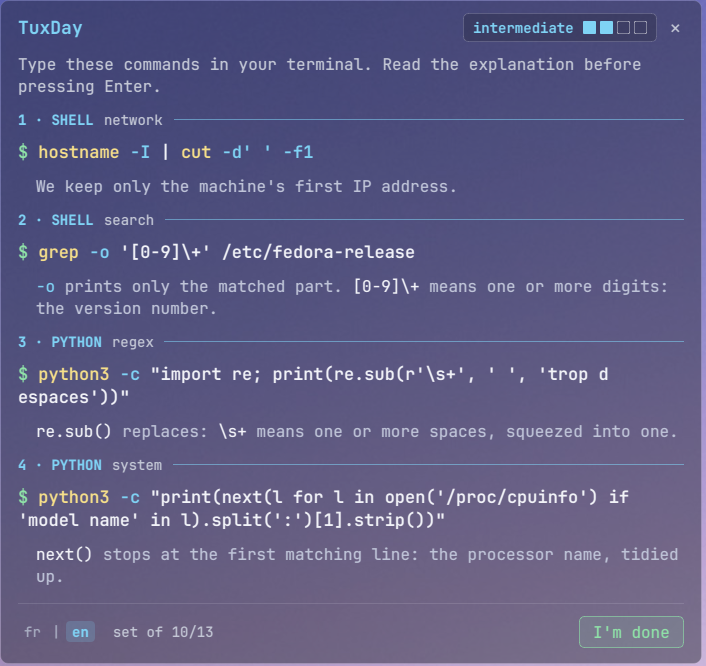

<p align="center">
  
</p>

<h1 align="center">TuxDay</h1>

<p align="center">4 commands a day to learn Linux and Python.</p>

<p align="center"><a href="README.md">Version française</a> · <a href="https://github.com/NicoPi-dev/TuxDay">github.com/NicoPi-dev/TuxDay</a></p>

<p align="center">
  
</p>

TuxDay is a small transparent window that opens on your desktop at every login and gives you **4 commands to type** in a terminal: 2 shell commands, then 2 Python commands. Each command comes with a short explanation. A few minutes a day are enough to learn Linux and Python step by step.

## What TuxDay does

- **One series a day**: restarting during the day shows the same series again.
- **4 levels** (beginner, intermediate, advanced, expert): the level changes every day, never the same one two days in a row.
- **Nearly 1,500 commands**, never the same one twice while new ones remain.
- **Create / remove pairs**: a command that creates something comes with its inverse command, which removes it.
- **A sandbox**: everything the commands create lives in `~/essai_linux`, which TuxDay creates at startup.
- **Only what works on your machine**: a command that needs a program missing from your system is never offered.
- **French and English**, switchable at the bottom of the window.

## Installation

TuxDay is made for **KDE Plasma 6**. It needs:

- Python 3 and PySide6;
- optionally, the JetBrains Mono font (otherwise, the system monospace font).

On Fedora:

```bash
sudo dnf install python3-pyside6 jetbrains-mono-fonts
```

Then download TuxDay and run the installer, without `sudo`:

```bash
git clone https://github.com/NicoPi-dev/TuxDay.git ~/TuxDay
cd ~/TuxDay
./install.sh
```

`install.sh` installs TuxDay for your user only:

- a KWin window rule that places TuxDay, keeps it below other windows and out of the taskbar (`~/.config/kwinrulesrc` is backed up first);
- autostart (`~/.config/autostart/tuxday.desktop`);
- an entry in the application menu, under Education, and its icon.

TuxDay stays in the folder you downloaded it to: don't move it, or run `./install.sh` again after moving it. It will open at your next login; to try it right away:

```bash
python3 -m tuxday
```


## Window position

By default, TuxDay opens at the top left of the screen (position `40,56`). To put it elsewhere, pass the X,Y coordinates of its top-left corner, in pixels, when installing:

```bash
./install.sh --position 600,56
```

To find the right values, move any window where you want TuxDay, then right-click its title bar → More Actions → Configure Special Window Settings… → Size & Position: the "Position" field shows its coordinates. You can run `./install.sh` again at any time to change the position.

## Uninstall

```bash
cd ~/TuxDay
./uninstall.sh
```

The script asks for confirmation (or use `./uninstall.sh -y` to skip it), then removes the KWin rule, autostart, the menu entry, the icon, and TuxDay's state and configuration. It leaves `~/essai_linux` (your experiments) and the TuxDay folder untouched; you can delete the folder by hand afterwards.

## Adding a language

Languages are discovered automatically from the files in `data/lang/`: adding a language means adding a file, with no code to change.

1. Copy `data/lang/en.json` to a file named after the language code, for example `data/lang/de.json` for German.
2. Translate the values, never the keys: `"done": "I'm done"` becomes `"done": "Fertig"`. `date_format` uses the [strftime](https://docs.python.org/3/library/datetime.html#strftime-and-strptime-format-codes) format (`%d.%m.` for example).
3. Restart TuxDay: a `de` button appears at the bottom of the window. If your system is in German (`LANG=de_…`), TuxDay picks it automatically.

Any label missing from the file is shown in French. Command explanations only exist in French and English (in `data/commands.json`): in any other language, they are shown in French.

Repository: https://github.com/NicoPi-dev/TuxDay — MIT license, see [LICENSE](LICENSE).
