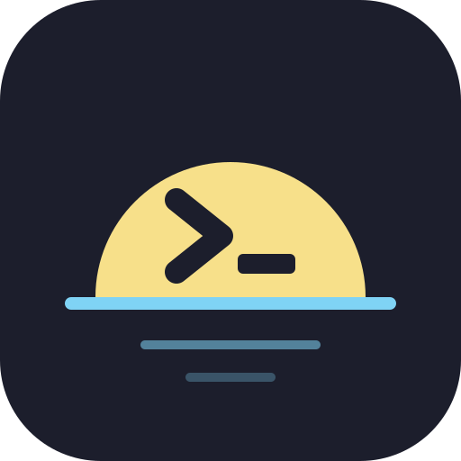
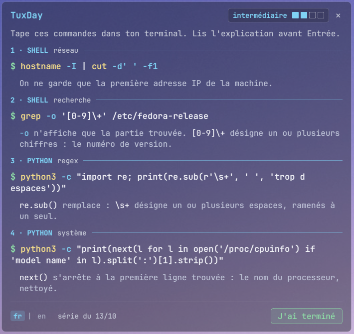

<p align="center">
  
</p>

<h1 align="center">TuxDay</h1>

<p align="center">4 commandes par jour pour apprendre Linux et Python.</p>

<p align="center"><a href="README.en.md">English version</a> · <a href="https://github.com/NicoPi-dev/TuxDay">github.com/NicoPi-dev/TuxDay</a></p>

<p align="center">
  
</p>

TuxDay est une petite fenêtre transparente qui s'ouvre sur votre bureau à chaque démarrage et vous propose **4 commandes à taper** dans un terminal : 2 commandes shell, puis 2 commandes Python. Chaque commande est suivie d'une courte explication. Quelques minutes par jour suffisent pour apprendre Linux et Python pas à pas.

## Ce que fait TuxDay

- **Une série par jour** : redémarrer dans la journée réaffiche la même série.
- **4 niveaux** (débutant, intermédiaire, avancé, expert) : le niveau change chaque jour, jamais deux jours de suite le même.
- **Près de 1 500 commandes**, jamais deux fois la même tant qu'il en reste de nouvelles.
- **Des paires créer / supprimer** : une commande qui crée quelque chose vient avec sa commande inverse, qui le supprime.
- **Un bac à sable** : tout ce que les commandes créent se trouve dans `~/essai_linux`, que TuxDay crée au démarrage.
- **Seulement ce qui marche chez vous** : une commande qui a besoin d'un programme absent de votre système n'est pas proposée.
- **Français et anglais**, au choix en bas de la fenêtre.

## Installation

TuxDay est fait pour **KDE Plasma 6**. Il lui faut :

- Python 3 et PySide6 ;
- en option, la police JetBrains Mono (sinon, la police monospace du système).

Sous Fedora :

```bash
sudo dnf install python3-pyside6 jetbrains-mono-fonts
```

Téléchargez ensuite TuxDay et lancez l'installation, sans `sudo` :

```bash
git clone https://github.com/NicoPi-dev/TuxDay.git ~/TuxDay
cd ~/TuxDay
./install.sh
```

`install.sh` installe TuxDay pour votre utilisateur seulement :

- une règle de fenêtre KWin qui place TuxDay, le garde sous les autres fenêtres et le retire de la barre des tâches (`~/.config/kwinrulesrc` est sauvegardé avant) ;
- le démarrage automatique (`~/.config/autostart/tuxday.desktop`) ;
- une entrée dans le menu des applications, catégorie Éducation, et son icône.

TuxDay reste dans le dossier où vous l'avez téléchargé : ne le déplacez pas, ou relancez `./install.sh` après l'avoir déplacé. Il s'ouvrira à la prochaine connexion ; pour l'essayer tout de suite :

```bash
python3 -m tuxday
```


## Position de la fenêtre

Par défaut, TuxDay s'ouvre en haut à gauche de l'écran (position `40,56`). Pour le placer ailleurs, passez les coordonnées X,Y de son coin haut gauche, en pixels, à l'installation :

```bash
./install.sh --position 600,56
```

Pour trouver les bonnes valeurs, déplacez une fenêtre à l'endroit voulu, puis faites un clic droit sur sa barre de titre → Plus d'actions → Configurer les paramètres spéciaux de la fenêtre… → Taille et position : le champ « Position » affiche ses coordonnées. On peut relancer `./install.sh` à tout moment pour changer de position.

## Désinstallation

```bash
cd ~/TuxDay
./uninstall.sh
```

Le script demande confirmation (ou `./uninstall.sh -y` pour ne rien demander), puis retire la règle KWin, le démarrage automatique, l'entrée du menu, l'icône, l'état et la configuration de TuxDay. Il ne touche pas à `~/essai_linux` (vos essais) ni au dossier de TuxDay, que vous pouvez supprimer ensuite à la main.

## Ajouter une langue

Les langues sont découvertes automatiquement d'après les fichiers de `data/lang/` : ajouter une langue, c'est ajouter un fichier, sans toucher au code.

1. Copiez `data/lang/en.json` sous le nom du code de la langue, par exemple `data/lang/de.json` pour l'allemand.
2. Traduisez les valeurs, jamais les clés : `"done": "I'm done"` devient `"done": "Fertig"`. `date_format` suit le format de [strftime](https://docs.python.org/3/library/datetime.html#strftime-and-strptime-format-codes) (`%d.%m.` par exemple).
3. Relancez TuxDay : un bouton `de` apparaît en bas de la fenêtre. Si votre système est en allemand (`LANG=de_…`), TuxDay le choisit tout seul.

Un libellé absent du fichier est affiché en français. Les explications des commandes, elles, n'existent qu'en français et en anglais (dans `data/commands.json`) : dans une autre langue, elles restent affichées en français.

Dépôt : https://github.com/NicoPi-dev/TuxDay — licence MIT, voir [LICENSE](LICENSE).
